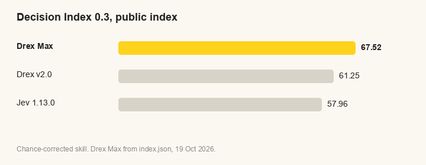
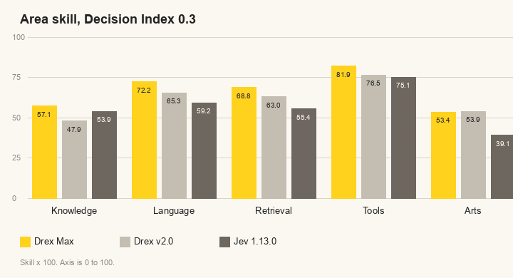
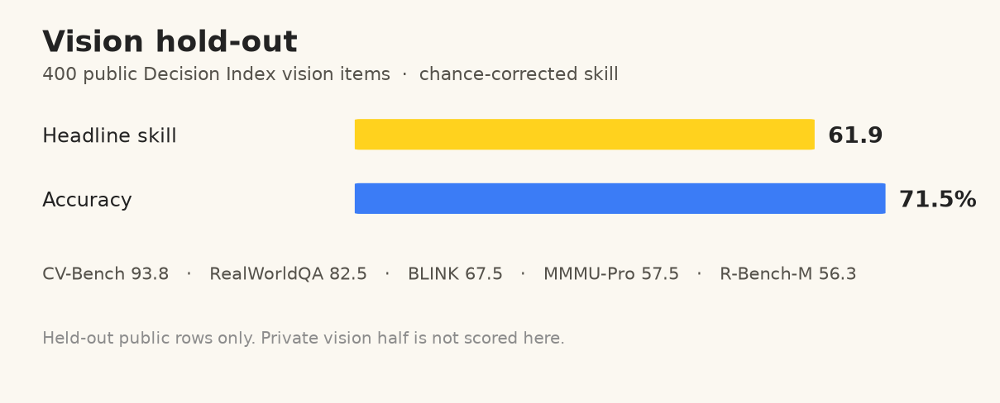

# Drex Max

**67.52 on the public Decision Index 0.4, and 73.92 on the public vision index.**

Drex Max, from [Nace.AI](https://www.nace.ai/), answers typed questions about a given context, in text, JSON and images. Pass the context as `state` ([request format](../../docs/request-format.md)) with one or more named questions, and get a probability for every option back in one forward pass. Nothing is generated. Drex Max is a dense 27B model with a 255-way readout head, and is released under the Nace.AI Open RAIL-M license.

[Weights](https://huggingface.co/nace-ai/drex-max-v1) · [Q8_0 GGUF](https://huggingface.co/nace-ai/drex-max-v1-Q8_0) · [affine Q4](https://huggingface.co/nace-ai/drex-max-v1-affine-q4) · [Drex v2.0](../drex-v2.0) · [Drex v1.5](../drex-v1.5)

It runs with Python on an NVIDIA GPU. On Apple silicon its text backbone runs on llama.cpp, Ollama, Kapitsa and MLX, and on the CPU with llama.cpp and Ollama. The default limit is 16,384 tokens per request. `DREX_MAX_CONTEXT=N` or `--max-length N` raises it up to the backbone's 262,144-token window (see [context length](../../docs/context-length.md)). The bf16 weights take about 49 GB, and loading the backbone in 8-bit takes about 26 GB.

<details>
<summary>How it works</summary>

The backbone has 64 layers: 48 Gated DeltaNet linear-attention layers that stay left to right, and 16 full-attention layers (every fourth) that are non-causal, so every token can attend to the whole sequence. Images go through the native vision tower and are visible to every question on the request. A 255-way readout in `readout.safetensors` turns the last hidden state into probabilities over up to 255 options. The bundled loader applies the non-causal attention; a plain causal chat run does not reproduce the scores below.

</details>

## Performance

As of 19 Oct 2026. Text scores are from the [results](https://huggingface.co/datasets/nace-ai/drex-max-v1-decision-index-results). Decision Index 0.4 uses this same public suite, so the scores are unchanged.

### Decision Index 0.4 (public text)

| Model | Public index | Raw | Knowledge & Reasoning | Language | Retrieval | Tools | Arts |
|---|---|---|---|---|---|---|---|
| **Drex Max** (27B) | **67.52** | 75.4 | 57.1 | 72.2 | 68.8 | 81.9 | 53.4 |
| Drex v2.0 (35B) | 61.25 | 70.55 | 47.9 | 65.3 | 63.0 | 76.5 | 53.9 |
| Jev 1.13.0 | 57.96 | 68.55 | 53.9 | 59.2 | 55.4 | 75.1 | 39.1 |

The public index averages 37 benchmarks in five areas. All 140,178 scoreable requests were answered (140,620 requests in the run). Unanswered requests count as wrong. Area columns are chance-corrected skill × 100, from `index.json`. The Drex v2.0 row is from its [results](https://huggingface.co/datasets/nace-ai/drex-v2.0-decision-index-results). The Jev row is the public-board row cited on the [Drex v2.0 page](../drex-v2.0#performance), from the [leaderboard](https://huggingface.co/spaces/multimodalart/jev-decision-index).

<p></p>

<p></p>

### JevBench

Drex Max scores 92.2% (213/231).

### Decision Bench v4

Drex Max scores 94.30% (1010/1071).

### Vision

Public vision index **73.92** on Decision Index 0.4, from [`vision-scores.json`](https://huggingface.co/datasets/nace-ai/drex-max-v1-decision-index-results/blob/main/runs/drex-max-v1-vision/vision-scores.json). All 12,210 rows were answered. The column is chance-corrected skill × 100. This run capped images at 1,638,400 pixels. R-Bench-M is weighted 0.5 and MMMU-Pro vision 0.25. The other rows are weighted 1.

| Benchmark | Rows | Skill |
|---|---|---|
| CV-Bench | 2,038 | 77.4 |
| BLINK | 961 | 59.9 |
| RealWorldQA | 589 | 72.3 |
| CharXiv | 532 | 80.5 |
| InfographicVQA | 244 | 97.3 |
| Mind2Web | 973 | 84.2 |
| Winoground | 800 | 85.0 |
| KIE (CORD+FUNSD) | 2,465 | 92.4 |
| Moderation (Hateful Memes) | 1,213 | 40.6 |
| R-Bench-M | 665 | 38.6 |
| MMMU-Pro vision | 1,730 | 47.3 |

<p></p>

## Python

Download the weights, install the requirements and run a request. The example is [`examples/request.json`](../../examples/request.json).

```bash
hf download nace-ai/drex-max-v1 --local-dir weights/drex-max-v1
pip install -r models/drex-max-v1/requirements.txt
python -m drex_max --model weights/drex-max-v1 --request examples/request.json
```

Add `--8bit` to load the backbone in 8-bit (CUDA, about 26 GB). Add `images` with file paths or `data:image/` URLs to the request to pass images. The loader accepts up to 4,194,304 pixels per image. The command needs Python 3.12 or newer.

From Python:

```python
from drex_max.model import DecisionModel, answer

model = DecisionModel("weights/drex-max-v1")
question = {
    "type": "choice",
    "instructions": "Which team should handle this ticket?",
    "criteria": {"billing": "Payments, charges, and refunds", "technical": "Bugs and outages", "other": "Anything else"},
}
row = {
    "state": {"ticket": "I was charged twice for the same order. Please refund the extra payment."},
    "question": question,
    # "images": ["receipt.jpg"],
}
print(answer(question, model.predict([row])[0]))
```

Response for `examples/request.json` from a bf16 run on an NVIDIA H100:

```json
{
  "answers": {
    "team": {
      "type": "choice",
      "choice": "billing",
      "confidence": 0.9982,
      "probabilities": { "billing": 0.9988, "technical": 0.0003, "other": 0.0009 }
    },
    "refund": { "type": "noul", "noul": 0.9974 },
    "urgency": {
      "type": "score",
      "score": 1.6522,
      "legend": { "0": "Routine", "1": "Soon", "2": "Urgent" },
      "probabilities": { "0": 0.0152, "1": 0.3173, "2": 0.6674 },
      "confidence": 0.4783
    }
  }
}
```

<details>
<summary>Tested hardware</summary>

NVIDIA H100 80 GB with bf16 weights (48.6 GiB loaded), and NVIDIA L40S 48 GB with the backbone in 8-bit (25.9 GiB loaded). Both answered `examples/request.json` and an image request, and the 8-bit probabilities are within 0.03 of bf16 on the example.

</details>

## Kapitsa

Kapitsa v0.2.25 or later runs the text backbone on Apple silicon. Native probabilities differ from the pinned v1 reference by up to 0.0329, above the 0.02 parity gate.

```bash
brew install nace-ai/tap/kapitsa
```

Import the [Q8_0 GGUF](https://huggingface.co/nace-ai/drex-max-v1-Q8_0), then write the readout head beside it. `kapitsa serve` does not run this model.

```bash
export KAPITSA_HOME="$HOME/.cache/kapitsa"
hf download nace-ai/drex-max-v1-Q8_0 drex-max-v1-Q8_0.gguf --local-dir weights/drex-max-v1-Q8_0
GGUF=weights/drex-max-v1-Q8_0/drex-max-v1-Q8_0.gguf
kapitsa import "$GGUF" --name drex-max-v1
kapitsa-drex-pointer "$GGUF" "$KAPITSA_HOME/models/drex-max-v1/pointer.bin"
kapitsa-systemone --model "$KAPITSA_HOME/models/drex-max-v1" --port 8000 --context 2048
```

```bash
curl -s localhost:8000/v1/systemone -d '{"state":"The shipment awaits inspection.","questions":{"route":{"type":"choice","instructions":"Which desk?","criteria":{"customs":"hold and inspect","transit":null}},"urgent":{"type":"noul","instructions":"Is the shipment urgent?"},"quality":{"type":"score","instructions":"How clear is the note?","criteria":["unclear","usable","clear"]}}}'
```

On a 48 GB Mac, use `--context 2048`. A larger context needs a monitored run. Images are not in the GGUF.

## MLX

MLX runs the affine Q4 checkpoint on Apple silicon. From the repository root:

```bash
python3 -m venv .venv-mlx
source .venv-mlx/bin/activate
python -m pip install -r requirements-mlx.txt
hf download nace-ai/drex-max-v1-affine-q4 --local-dir weights/drex-max-v1-affine-q4
python drex_max_mlx.py --model weights/drex-max-v1-affine-q4 --request examples/request.json
```

The command prints System One JSON with `model`, `answers`, and `usage`. It also reads a request from standard input and accepts a batch in `requests`. Questions support `choice`, `noul`, and `score`. Text only. The default maximum is 16,384 tokens per question.

## Affine Q4

[nace-ai/drex-max-v1-affine-q4](https://huggingface.co/nace-ai/drex-max-v1-affine-q4) is an affine 4-bit, group-64 text checkpoint. MLX runs it. Images are not in that file.

On an Apple M5 Pro, 48 GB, macOS 26.5.2, 30 Oct 2026, at context 2,048, 21 probability fields differed from the recorded answers of `drex-max-v1-Q8_0.gguf` by at most 0.0329, above the 0.02 parity gate. Two fields were over 0.02. No choice flipped. An MLX scoring of the same bytes differed by at most 0.0356, with two over 0.02 and no choice flip. llama.cpp Q4_K_M is not in that repository.

## llama.cpp

Runs the text backbone on Apple silicon (Metal) and on the CPU; images need the Python path. Run these from the repository root:

```bash
git clone --branch drex-max-v1 --single-branch https://github.com/nace-ai/llama.cpp.git
cmake -S llama.cpp -B llama.cpp/build
cmake --build llama.cpp/build -j --target llama-server

python llama.cpp/convert_hf_to_gguf.py weights/drex-max-v1 --no-mtp --outtype q8_0 \
  --outfile weights/drex-max-v1/drex-max-v1-Q8_0.gguf

llama.cpp/build/bin/llama-server -m weights/drex-max-v1/drex-max-v1-Q8_0.gguf \
  -np 1 -c 16384 -b 16384 -ub 16384 --no-warmup --port 8000
```

The server answers `POST /v1/systemone` with the same request and response as the Python path, minus `images`. The Q8_0 GGUF is 27,250,125,216 bytes. The conversion needs the bf16 weights, about 49 GB, on disk. To skip it, download the ready-made [Q8_0 GGUF](https://huggingface.co/nace-ai/drex-max-v1-Q8_0) (`hf download nace-ai/drex-max-v1-Q8_0 drex-max-v1-Q8_0.gguf --local-dir weights/drex-max-v1-Q8_0`) and pass its path to `llama-server`.

Drex Max reads each question as one whole prompt, so `-b` and `-ub` equal `-c` and one request holds up to that many tokens. For longer requests set `SYSTEMONE_CONTEXT=N` and use `-c N -b N -ub N` ([Context length](../../docs/context-length.md)).

<details>
<summary>Tested hardware</summary>

Apple M5 Pro (18-core CPU, 20-core GPU, 48 GB unified memory, macOS 26.5.2): the Q8_0 GGUF on Metal answers `examples/request.json` within 0.02 of the bf16 weights run with Python on an NVIDIA H100.

</details>

## Ollama

Use the Nace fork of Ollama with a `llama-server` built from the `drex-max-v1` branch above. Convert the GGUF first, as in the llama.cpp steps.

<details>
<summary>Build the fork</summary>

From the repository root:

```bash
git clone --branch drex-max-v1 --single-branch https://github.com/nace-ai/ollama.git
cd ollama
export OLLAMA_LLAMA_CPP_SOURCE="$PWD/../llama.cpp"
cmake -S llama/server --preset darwin
cmake --build build/llama-server-darwin --target llama-server --parallel 8
GOTOOLCHAIN=auto go build -trimpath -o ollama .
cd ..
```

For the CPU use the `cpu` preset and `build/llama-server-cpu` in place of `darwin` and `build/llama-server-darwin` here and below.

</details>

Write a `Modelfile` next to the GGUF:

```bash
cat > weights/drex-max-v1/Modelfile <<'EOF'
FROM ./drex-max-v1-Q8_0.gguf
CAPABILITY decision
PARAMETER num_ctx 16384
PARAMETER num_gpu 40
EOF
```

Start the daemon with the fork's binary and leave it running:

```bash
OLLAMA_HOST=127.0.0.1:11434 \
OLLAMA_LLAMA_SERVER="$PWD/ollama/build/llama-server-darwin/bin/llama-server" ollama/ollama serve
```

In another terminal, import and call the model:

```bash
OLLAMA_HOST=127.0.0.1:11434 ollama/ollama create drex-max-v1 -f weights/drex-max-v1/Modelfile
jq '. + {model: "drex-max-v1"}' examples/request.json | curl http://127.0.0.1:11434/v1/systemone \
  -H 'Content-Type: application/json' -d @-
```

Ollama needs `"model"` in the request, which the `jq` filter adds. `num_gpu 40` offloads 40 layers to Metal on a 48 GB Mac; use `PARAMETER num_gpu 0` for the CPU. The default is 16,384 tokens; for longer requests set `PARAMETER num_ctx N`, import again, and start the daemon with `SYSTEMONE_CONTEXT=N`.

<details>
<summary>Tested hardware</summary>

Through Ollama on the Apple M5 Pro above, the Q8_0 GGUF with `num_gpu 40` gives the same answers as `llama-server`.

</details>

## Files

| | |
|---|---|
| `model-*.safetensors`, `config.json` | The backbone after the decision fine-tune (bf16) |
| `readout.safetensors` | The 255-way decision head |
| `decision_config.json` | Option codes, temperature and the non-causal attention setting |
| `code/drex_max/` | The loader: attention mask, readout and images |
| `inference.py` | Scores a request from a checkpoint directory |
